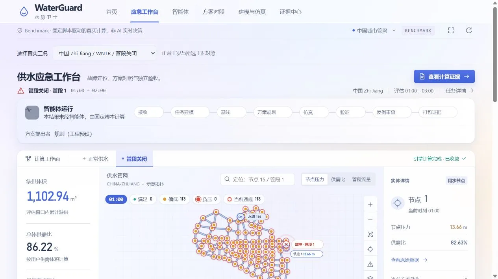
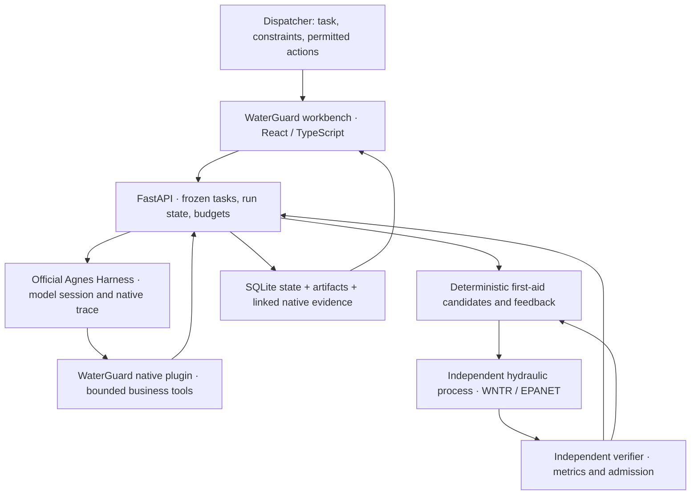

# WaterGuard · 水脉卫士

English | [简体中文](README.zh-CN.md)

<div align="center">

**Emergency water-network response, hydraulic verification, and traceable decisions.**

Built on Agnes Harness · WNTR / EPANET · React + TypeScript

[Project Overview](#project-overview) · [Demo Video](#demo-video) · [Architecture](#architecture) · [Integration Standards](#integration-standards) · [Getting Started](#getting-started)

</div>



## Project Overview

### Background

A pipe closure, leak, or burst can interrupt water supply across a connected network. Dispatchers need to understand the affected nodes, compare permitted response actions, and see whether a proposed plan actually restores service. WaterGuard brings this workflow into one workbench: **freeze the task, propose actions, run hydraulics, verify the outcome, and retain the evidence.**

The default demonstration uses the **Zhi Jiang research network from China**, with 113 demand nodes, one reservoir, and 164 pipes. EPA Net1 and Net3 examples are also available. These are published research/example models; their sources, scenario assumptions, and reproducible calculations are documented in [Chinese network integration](docs/中国管网接入.md) and [data provenance](data/README.md).

### Core Features

| Capability | What users can do |
| --- | --- |
| Emergency workbench | Inspect network topology, pressure, flow, supply ratios, affected nodes, and time intervals for normal, closure, leak, burst, and isolation scenarios. |
| Task and response planning | Confirm the network, fault, service targets, allowed facilities, action timing, and budgets before starting a run. |
| Agnes-assisted response | Use deterministic first-aid candidates for an initial response, then let Agnes in AGH inspect feedback and attempt permitted refinements when service gaps remain. |
| Plan comparison | Compare candidates under the same frozen task, including normal-service coverage, emergency coverage, water deficit, and remaining supply gaps. |
| Independent verification | Calculate metrics from hydraulic outputs and display action validity, simulation validity, nominal compliance, stress-test compliance, and full recommendation eligibility separately. |
| Execution and evidence | Follow persisted workflow events, native tool summaries, logs, cancellation and recovery; inspect original results and export linked evidence. |
| Decision experiments | Explore failure boundaries, minimum remedies, and event-driven reassessment in a separate research workspace. The current GNN extension is implemented but remains unvalidated; see [research status](docs/决策实验与物理代理.md). |

### Innovation and Recorded Outcome

WaterGuard combines **fast deterministic first aid, model-driven feedback refinement, and independent physical verification**. The model chooses tools and proposes actions; a solver produces numerical results, and a verifier determines compliance. Every candidate stays bound to the task version, constraints, network, and original evidence.

The workbench distinguishes a **fully compliant recommendation** from a **best-effort emergency response**. A useful response can reduce water shortage while leaving explicit service gaps; the interface retains the original admission result and identifies the response's actual source.

The recorded October 13, 2026 Net3 pipe-123 closure case used a real Agnes session with **8 simulations and 40 model calls**. The delivered first-aid plan reduced water deficit from **191.143 to 94.198 m³** and increased full-window emergency coverage from **74 to 76 of 92 demand nodes**. Emergency average attainment reached **93.07%**, while full-window normal coverage was **51/92**. Agnes refinement produced **no strict improvement**, so the system retained the deterministic plan. Full compliance failed, the run's required stress-test state remained pending, and 398 normal-service gap records remained. These are results for one frozen task; node coverage is not a population percentage. See the [recorded comparison, timing, and evidence](docs/submission/民生优先与混合策略验收.md).

## Demo Video

### Team Demonstration · 4 min 55 sec · With Audio

https://github.com/user-attachments/assets/55beeaad-4009-4589-8524-9733017b9317

[Download the original MP4](https://github.com/wblxr408/WaterGuard/releases/download/submission-20261013/WaterGuard-team-demonstration.mp4)

### Emergency Response Walkthrough · 3 min 38 sec · Silent

https://github.com/user-attachments/assets/00c9076a-00e1-4f04-b3c1-5a980a80e3fd

[Download MP4](https://github.com/wblxr408/WaterGuard/releases/download/submission-20261013/WaterGuard-rescue-demonstration-20261014.mp4) · [Video timeline](docs/submission/视频时间索引.md) · [Video archive](docs/submission/videos/README.md)

The October 14 walkthrough replays saved runs, including recommendation provenance, zero refinement gain, remaining supply gaps, candidate switching, native logs, and evidence. Its duration is not the solver or model runtime, and the recording did not rerun the plans.

## Architecture

### End-to-End Workflow



AGH runs the model's tool-selection and feedback loop. WaterGuard owns task freezing, permitted actions, calculation jobs, independent verification, and evidence. The hybrid strategy delivers first aid before spending the remaining budget on model refinement. Native AGH traces and application events are stored as distinct, linked records.

### Core Modules

| Module | Implementation and responsibility |
| --- | --- |
| [Workbench](apps/web-gpt/README.md) | React, TypeScript, Vite, Three.js, and team-built Blender assets; network analysis, candidate comparison, agent workflow, and evidence views. Visual assets do not supply hydraulic parameters. |
| [Official AGH integration](docs/AGH基座与启动.md) | Git submodule at `vendor/agnes-harness`, pinned to `fe90962a6b8561d8cae7e5d451905604fcf475cf`; official SDK bridge in `scripts/agh_bridge.mjs` and model configuration through AGH. |
| [Native business plugin](packages/waterguard-agh/README.md) | `waterguardTools` Cordis plugin; network/task reads, candidate generation, submission, simulation, verification, diagnosis, revision, perturbation, and evidence tools. |
| [Task API](services/api/main.py) | Python/FastAPI; immutable task revisions, SQLite run state, budgets, cancellation, linked recovery, and persisted SSE. |
| [Hydraulics](services/hydraulics/physical.py) | WNTR / EPANET adapters, explicit fault and action compilation, independent calculation processes, raw outputs, and recorded engine/input provenance. |
| [Verifier](services/verifier/service.py) and [evidence service](services/evidence/service.py) | Recalculate metrics and admission from original results; package task, plan, simulation, verification, artifacts, and native-session references. |
| [Shared contracts](packages/contracts/README.md) | JSON Schema 0.4.0, generated TypeScript types, Python validation, and explicit run modes. |
| [Decision studies](docs/决策实验与物理代理.md) | Separate failure-boundary, remedy, and event-reassessment studies; optional PyTorch Geometric pressure-residual surrogate for selecting fine evaluations. |

The delivered contest workflow uses **one bounded AGH session with staged work**. The role-oriented design documents describe further architecture; they do not establish isolated multi-agent execution. The current optional GNN has no supplied trained weights, and its October 26 code addition was not trained, built, or validated in that delivery. Jev integration exists as an optional path; it was not configured in the recorded submission.

## Integration Standards

The following are WaterGuard's implemented interface and data conventions. Integrations should use this repository's pinned AGH revision and executable contracts.

### HTTP API and Event Streaming

The task service defaults to `http://127.0.0.1:8010`. FastAPI exposes its generated OpenAPI document at `/openapi.json` and interactive documentation at `/docs`. The frontend accesses the task service through the Vite `/wg` proxy.

| Method and path | Purpose |
| --- | --- |
| `GET /api/networks` | List available network manifests. |
| `POST /api/task-proposals` | Preview a proposed task. |
| `POST /api/tasks/from-proposal` | Create and freeze a task; returns 201. |
| `POST /api/tasks/{task_id}/runs` | Start a selected run mode; returns 202 and accepts an `idempotency_key` in the JSON body. |
| `GET /api/runs/{run_id}/workspace` | Read candidates, outcomes, and recommendation presentation. |
| `POST /api/runs/{run_id}/cancel` | Request cancellation. |
| `GET /api/runs/{run_id}/stream` | Subscribe to persisted `workflow`, `info`, and `run` SSE events. |
| `GET /api/simulations/{simulation_id}/series` | Read time-series data, optionally filtered by node and time window. |
| `GET /api/runs/{run_id}/evidence` | Read the evidence manifest. |
| `GET /api/runs/{run_id}/evidence/download` | Download the evidence archive. |
| `POST /api/decision-studies` | Start a separate decision study; see its [request model and routes](docs/决策实验与物理代理.md). |

SSE uses persisted sequence numbers as event IDs and supports `Last-Event-ID` on reconnect. Consumers should handle named events, retain the cursor, and wait for the independent verification result. Completion is signaled by `stream.complete`. The older `/events` endpoint provides finite history. Examples and proxy configuration are in the [frontend guide](apps/web-gpt/README.md).

### Data Contracts and Numerical Conventions

| Convention | Contract |
| --- | --- |
| Structure | [JSON Schema Draft 7, version 0.4.0](packages/contracts/schema/waterguard.schema.json) is the editable source for public structures, including `TaskSpec`, `ActionPlan`, `SimulationResult`, `VerificationReport`, `RunRecord`, and `EvidenceManifest`. Generated TypeScript types complement Python runtime and semantic validation. |
| Units | Length and pressure head: m; flow: m³/s; time: s. Adapters convert source INP units. |
| Time series | Values hold from the interval start over `[time_s, time_s + duration_s)`. Leakage is excluded from water delivered to users. |
| Run modes | `live`: model-driven AGH parent run; `benchmark`: deterministic physical computation, including hydraulic child runs; `replay`: saved evidence; `fixture`: manually constructed development data. |
| Admission | `action_valid`, `simulation_valid`, `nominal_constraints_pass`, `required_stress_tests_pass`, and `recommendation_eligible` each use `pass / fail / pending`. A completed run does not imply full compliance. |
| Input binding | Task revisions and `constraint_hash`, plan `plan_hash`, and simulation `input_hash` preserve the relationship between inputs and outputs. Python owns hash serialization; consumers forward these values. |
| Serialization | This version uses Python `json.dumps(sort_keys=True, separators=(',', ':'), ensure_ascii=True, allow_nan=False)` for task/plan hashing; it does not implement RFC 8785 canonicalization. |
| Artifacts | UTF-8 JSON/JSONL and CSV outputs, SHA-256 artifact manifests, original source/engine records, and linked AGH traces. Integrity hashes establish consistency, not physical calibration. |

Changes to the network, action permissions, or service targets create a new frozen task revision. Integrations must preserve the recorded distinction between best-effort emergency delivery and full admission. Detailed field, timing, and compatibility rules are in the [contract guide](packages/contracts/README.md).

### AGH and External Integration

- Install the native plugin with the official SDK as described in the [AGH setup guide](docs/AGH基座与启动.md). Its `wg_*` tools call the local API; the backend associates the AGH session with the frozen task and run.
- The default contest provider is Agnes; DeepSeek and GLM are supported configuration options. Configure and test your own account through **Agent → Model accounts** in WaterGuard. See [model integration](docs/模型接入.md).
- Model tools can propose permitted actions and request calculations. They cannot rewrite task constraints or set verification pass flags. Current tools generate local simulations and evidence; no field-device control is connected.
- A missing model account returns `503 MODEL_NOT_CONFIGURED`; an unavailable AGH daemon returns `503 AGH_UNAVAILABLE`.
- To add a network or solver, preserve model provenance and license, provide the manifest/overlay/action catalog, and implement the existing adapter and result contracts. To add a UI, consume the API/SSE contracts and keep run mode, task binding, and independent admission visible.

## Getting Started

### Review the Submitted Demonstration

[Submission Release](https://github.com/wblxr408/WaterGuard/releases/tag/submission-20261013) contains the videos and complete demonstration/evidence packages. The [submission package under 200 MB](https://github.com/wblxr408/WaterGuard/releases/download/submission-20261013/WaterGuard-submission-public-record-under-200MB-20261014.zip) excludes videos and includes the recorded demonstration database. Follow the [package guide](docs/submission/200MB报名包说明.md) and [offline playback instructions](docs/submission/完整包运行说明.md).

The automatic GitHub “Source code” archive contains tracked source only. Use the Release attachments to review the complete recorded evidence and saved runs.

### Run from Source

For the complete AGH workflow, use **Python 3.11, Node.js ≥24.10, pnpm 10.34.5**, and PowerShell 7 on Windows. Native AGH builds on Windows also require Visual Studio C++ Build Tools and Windows SDK.

```powershell
git clone --recurse-submodules https://github.com/wblxr408/WaterGuard.git
cd WaterGuard
python -m venv .venv
.venv/Scripts/python.exe -m pip install -r services/api/requirements.txt -r services/hydraulics/requirements.txt
cd apps/web-gpt
npm.cmd ci
cd ../..
```

Build the pinned official AGH and install the WaterGuard plugin using the [first-build instructions](docs/AGH基座与启动.md). Then follow the [three-terminal startup procedure](docs/submission/复现与运行.md) for the API, AGH, and frontend.

| Local entry | Default URL |
| --- | --- |
| WaterGuard workbench | `http://127.0.0.1:5173/` |
| Task API documentation | `http://127.0.0.1:8010/docs` |
| Official AGH session inspection | `http://127.0.0.1:4180/` |

Saved evidence can be read without a model account. New Live runs require a configured account and perform new model calls and calculations. Local runtime artifacts are stored under `artifacts/`; the [reproduction guide](docs/submission/复现与运行.md) explains database restoration and the existing recorded run IDs.

## Documentation and Reproducibility

Most detailed engineering and submission documents below are currently in Chinese.

| Resource | Contents |
| --- | --- |
| [Submission index](docs/submission/README.md) · [submission notes](docs/参赛提交说明.md) | Project description, team materials, versioned deliverables, and submission entries. |
| [Evidence index](docs/submission/证据索引.md) · [native AGH exports](docs/submission/官方AGH轨迹导出.md) | Original calculations, native traces, and artifact locations. |
| [Recorded hybrid evaluation](docs/submission/民生优先与混合策略验收.md) · [same-budget comparison](docs/submission/同预算对照与消融.md) | Actual response quality, refinement results, limits, and experimental evidence. |
| [Per-node dispatch and stress tests](docs/逐节点保供调度与可配置复验.md) | Frozen objectives, per-node service duration, and configurable demand perturbations. |
| [Hydraulic reproduction](docs/同学1交付与复现.md) · [physical model assessment](docs/物理模型与算法评估.md) | Solver inputs, raw outputs, assumptions, and physical scope. |
| [Frontend design](docs/前端设计.md) · [backend design](docs/后端设计.md) · [agent design](docs/Agent设计.md) | Detailed design rationale; current executable contracts and implementation determine delivered behavior. |
| [AGH acceptance manual](docs/AGH验收操作手册.md) · [historical contest evaluation](docs/赛事逐项验收与评分分析.md) | Recorded success, repair, cancellation, recovery, and historical acceptance results. |
| [Decision experiments and surrogate](docs/决策实验与物理代理.md) | Research inputs, coarse/fine evaluation, optional GNN, and its current validation status. |

Recorded test totals belong to their documented revisions. This README update does not constitute a new runtime evaluation. The published models have not been field-calibrated; current evidence covers modeled hydraulics rather than water hammer, water quality, or a deployed utility control system.

## Attribution and References

Third-party software, network data, and visual assets retain their own licenses. Zhi Jiang data is **CC BY-NC 4.0**, attributed to Graeme Dandy / University of Kentucky Libraries. The repository does not grant a new blanket license to team-authored work. See the [third-party attribution table](docs/submission/第三方归属表.md), [data guide](data/README.md), and original license files.

[Agnes Harness](https://github.com/AgnesAI-Labs/agnes-harness) · [WNTR models](https://usepa.github.io/WNTR/libraries.html) · [WNTR hydraulics](https://usepa.github.io/WNTR/hydraulics.html) · [Competition](https://agnes-ai.cn/hackathon)
