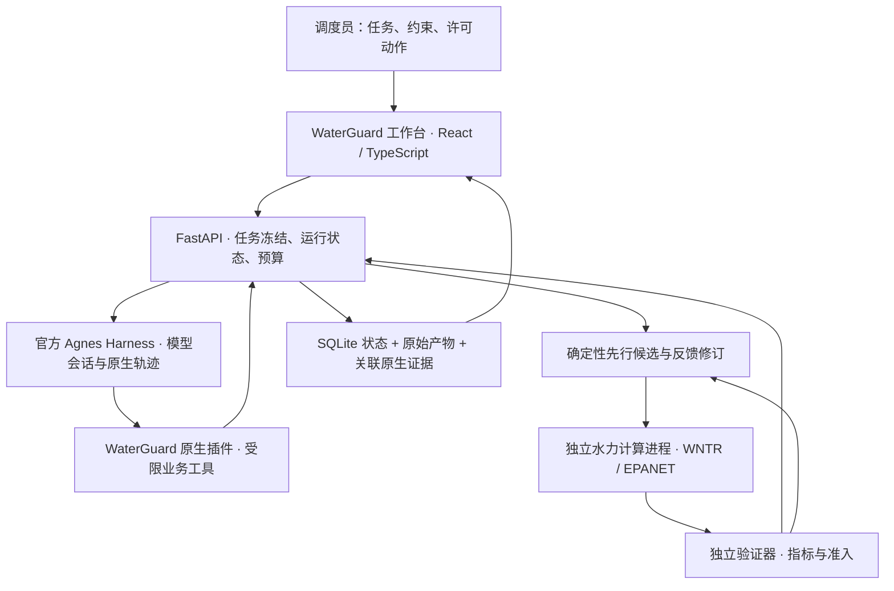

# WaterGuard · 水脉卫士

[English](README.md) | 简体中文

<div align="center">

**面向供水管网突发故障的应急处置、水力验证与决策证据工作台。**

基于 Agnes Harness · WNTR / EPANET · React + TypeScript

[项目介绍](#项目介绍project-overview) · [视频介绍](#视频介绍demo-video) · [架构介绍](#架构介绍architecture) · [集成标准](#集成标准integration-standards) · [快速开始](#快速开始)

</div>


## 项目介绍（Project Overview）

### 项目背景

管段关闭、泄漏或断裂会通过互联管网影响供水。调度人员需要了解受影响节点、比较许可范围内的处置动作，并确认方案是否真正恢复供水。WaterGuard 将这一过程放入同一工作台：**冻结任务、提出动作、执行水力仿真、独立验证结果、保留完整证据。**

默认演示采用**中国 Zhi Jiang 研究管网**，包含 113 个用水节点、1 个水源和 164 条管道，同时支持 EPA Net1、Net3 示例网络。这些是公开研究或示例模型，来源、场景假设及复现方式见[中国管网接入](docs/中国管网接入.md)和[数据来源说明](data/README.md)。

### 核心功能

| 功能 | 用户可以完成的操作 |
| --- | --- |
| 应急工作台 | 查看正常、关闭、泄漏、断裂、隔离工况下的拓扑、压力、流量、供需比、受影响节点和时段。 |
| 任务与处置规划 | 在启动前确认管网、故障、保供目标、许可设施、动作时刻和预算。 |
| Agnes 辅助处置 | 由确定性先行处置提供初始方案；存在供水缺口时，由 AGH 中的 Agnes 读取反馈并尝试许可范围内的精修。 |
| 方案对照 | 在同一冻结任务下比较正常供水、应急覆盖、缺水量和剩余供水缺口。 |
| 独立验证 | 从水力原始结果计算指标，分别显示动作合法、仿真有效、名义达标、扰动复验和完整推荐准入。 |
| 执行与证据 | 查看持久化工作流、原生工具摘要和日志，取消或恢复运行，读取原始结果并导出关联证据。 |
| 决策实验 | 在独立研究工作区探索失效边界、最小补救和事件重评。当前 GNN 扩展已加入代码，仍待验证，见[研究状态](docs/决策实验与物理代理.md)。 |

### 创新亮点与实测结果

WaterGuard 将**快速确定性先行处置、模型反馈精修、独立物理验证**结合起来。模型选择工具并提出动作，求解器产生数值，验证器判定是否达标。候选始终绑定任务版本、约束、管网和原始证据。

工作台区分**完全达标推荐**与**尽力挽救的应急处置推荐**。有效处置可以减少缺水，同时仍存在供水缺口；界面保留原始准入结论，并说明最终方案的实际来源。

2026 年 10 月 13 日记录的 Net3 管段 123 关闭案例，真实 Agnes 会话共执行 **8 次仿真、40 次模型调用**。最终交付的先行处置方案将缺水量从 **191.143 降至 94.198 m³**，全程应急覆盖从 **74/92 提升至 76/92 个用水节点**，应急平均达标率达到 **93.07%**，全程正常覆盖为 **51/92**。Agnes 精修**没有严格增益**，因此系统保留确定性方案。完整达标准入仍失败，该运行要求的扰动复验状态仍为 pending，并保留 398 条正常层供水缺口记录。以上是一个冻结任务的实际结果，节点覆盖率不代表人口比例。完整对照、耗时口径及原始证据见[民生优先与混合策略验收](docs/submission/民生优先与混合策略验收.md)。

## 视频介绍（Demo Video）

### 团队演示视频 · 4 分 55 秒 · 有声音

https://github.com/user-attachments/assets/55beeaad-4009-4589-8524-9733017b9317

[下载原清晰版 MP4](https://github.com/wblxr408/WaterGuard/releases/download/submission-20261013/WaterGuard-team-demonstration.mp4)

### 应急挽救演示 · 3 分 38 秒 · 无音轨

https://github.com/user-attachments/assets/00c9076a-00e1-4f04-b3c1-5a980a80e3fd

[下载 MP4](https://github.com/wblxr408/WaterGuard/releases/download/submission-20261013/WaterGuard-rescue-demonstration-20261014.mp4) · [视频时间索引](docs/submission/视频时间索引.md) · [视频归档](docs/submission/videos/README.md)

10 月 14 日演示回看已有运行，包括推荐来源、精修零增益、剩余供水缺口、候选切换、原生日志和证据。视频时长不等于求解或模型运行耗时，录制时没有重新运行方案。

## 架构介绍（Architecture）

### 完整业务链路



AGH 运行模型的工具选择与反馈循环。WaterGuard 负责冻结任务、限定动作、管理计算作业、独立验证和证据存储。混合策略先完成保底处置，再使用剩余预算进行模型精修。AGH 原生轨迹与应用事件分别存储并关联。

### 核心模块与实现方式

| 模块 | 技术与职责 |
| --- | --- |
| [工作台前端](apps/web-gpt/README.md) | React、TypeScript、Vite、Three.js 与团队自建 Blender 资产；提供管网分析、候选对照、智能体工作流和证据界面。视觉资产不提供水力参数。 |
| [官方 AGH 接入](docs/AGH基座与启动.md) | Git 子模块位于 `vendor/agnes-harness`，固定提交 `fe90962a6b8561d8cae7e5d451905604fcf475cf`；通过 `scripts/agh_bridge.mjs` 的官方 SDK 桥接与 AGH 模型配置服务接入。 |
| [原生业务插件](packages/waterguard-agh/README.md) | `waterguardTools` Cordis 插件；提供管网/任务读取、候选生成、提交、仿真、验证、诊断、修订、扰动和证据工具。 |
| [任务 API](services/api/main.py) | Python / FastAPI；管理不可变任务版本、SQLite 运行状态、预算、取消、关联恢复和持久化 SSE。 |
| [水力计算](services/hydraulics/physical.py) | WNTR / EPANET 适配器，显式故障与动作编译、独立计算进程、原始输出及引擎/输入来源记录。 |
| [独立验证器](services/verifier/service.py)与[证据服务](services/evidence/service.py) | 从原始结果复算指标与准入，打包任务、计划、仿真、验证、文件清单和原生会话引用。 |
| [公共契约](packages/contracts/README.md) | JSON Schema 0.4.0、生成的 TypeScript 类型、Python 校验和明确的运行模式。 |
| [决策实验](docs/决策实验与物理代理.md) | 独立的失效边界、补救与事件重评研究；可选 PyTorch Geometric 压力残差代理用于选择精验点。 |

已交付的赛事工作流采用**单个受限 AGH 会话分阶段执行**。角色化设计文档保留后续架构依据，不表示已实现多智能体隔离。当前可选 GNN 未附带训练好的权重，10 月 26 日新增代码交付时未训练、构建或验证。Jev 保留可选接入路径，已有参赛记录未配置 Jev。

## 集成标准（Integration Standards）

以下为 WaterGuard 已实现的接口与数据约定。接入时应使用本仓库固定的 AGH 版本和可执行契约。

### HTTP API 与事件流

任务服务默认地址为 `http://127.0.0.1:8010`。FastAPI 在 `/openapi.json` 提供生成的 OpenAPI 文档，在 `/docs` 提供交互文档。前端通过 Vite 的 `/wg` 代理访问任务服务。

| 方法与路径 | 用途 |
| --- | --- |
| `GET /api/networks` | 获取可用管网清单。 |
| `POST /api/task-proposals` | 预览任务提案。 |
| `POST /api/tasks/from-proposal` | 创建并冻结任务，返回 201。 |
| `POST /api/tasks/{task_id}/runs` | 启动指定模式运行，返回 202；JSON 请求体接受 `idempotency_key`。 |
| `GET /api/runs/{run_id}/workspace` | 获取候选、结果和推荐展示。 |
| `POST /api/runs/{run_id}/cancel` | 请求取消运行。 |
| `GET /api/runs/{run_id}/stream` | 订阅持久化的 `workflow`、`info`、`run` SSE 事件。 |
| `GET /api/simulations/{simulation_id}/series` | 读取时序，可按节点和时间窗过滤。 |
| `GET /api/runs/{run_id}/evidence` | 获取证据清单。 |
| `GET /api/runs/{run_id}/evidence/download` | 下载证据包。 |
| `POST /api/decision-studies` | 启动独立决策研究，见[请求模型与接口说明](docs/决策实验与物理代理.md)。 |

SSE 使用持久化序号作为事件 ID，重连支持 `Last-Event-ID`。消费端应处理命名事件、保存游标，并等待独立验证结果；`stream.complete` 表示流已完成。旧 `/events` 接口提供有限历史。消费示例及代理配置见[前端说明](apps/web-gpt/README.md)。

### 数据契约与数值约定

| 约定 | 规范 |
| --- | --- |
| 数据结构 | [JSON Schema Draft 7，版本 0.4.0](packages/contracts/schema/waterguard.schema.json)是公共结构的可编辑来源，包括 `TaskSpec`、`ActionPlan`、`SimulationResult`、`VerificationReport`、`RunRecord`、`EvidenceManifest`。生成的 TypeScript 类型与 Python 运行时、语义校验共同约束数据。 |
| 单位 | 长度、压力水头为 m，流量为 m³/s，时间为 s；适配器转换原始 INP 单位。 |
| 时序 | 区间起点值保持到 `[time_s, time_s + duration_s)` 末端；泄漏不计入用户供水。 |
| 运行模式 | `live` 为模型驱动的 AGH 父运行；`benchmark` 为确定性物理计算，包含水力子运行；`replay` 为保存证据回放；`fixture` 为人工开发样例。 |
| 准入状态 | `action_valid`、`simulation_valid`、`nominal_constraints_pass`、`required_stress_tests_pass`、`recommendation_eligible` 均使用 `pass / fail / pending`。运行完成不代表完全达标。 |
| 输入绑定 | 任务版本与 `constraint_hash`、计划 `plan_hash`、仿真 `input_hash` 维持输入输出关联。Python 负责哈希序列化，消费端转发这些值。 |
| 序列化 | 本版任务/计划哈希使用 Python `json.dumps(sort_keys=True, separators=(',', ':'), ensure_ascii=True, allow_nan=False)`，未实现 RFC 8785 规范化。 |
| 产物 | UTF-8 JSON/JSONL、CSV、SHA-256 文件清单、原始来源/引擎记录与关联 AGH 轨迹。完整性哈希证明一致性，不证明现场物理校准。 |

修改管网、动作权限或保供目标时创建新的冻结任务版本。集成方应保留“尽力挽救交付”与“完整达标准入”的区别。字段、时间语义及兼容规则见[契约说明](packages/contracts/README.md)。

### AGH 与外部接入方式

- 按[AGH 基座与启动](docs/AGH基座与启动.md)通过官方 SDK 安装原生插件。`wg_*` 工具调用本机 API，后端将 AGH 会话关联到冻结任务与运行。
- 默认赛事提供商为 Agnes，同时支持 DeepSeek、GLM 配置。用户在 WaterGuard 的“智能体 → 模型账号”配置并测试自己的账号，见[模型接入](docs/模型接入.md)。
- 模型工具可以提出许可动作、请求计算，不能改写任务约束或填写验证通过标志。现有工具产生本地仿真和证据，未接入现场设备控制。
- 未配置模型账号时返回 `503 MODEL_NOT_CONFIGURED`；AGH daemon 不可用时返回 `503 AGH_UNAVAILABLE`。
- 新增管网或求解器时保留模型来源与许可，提供 manifest、overlay 和动作目录，并实现现有适配器及结果契约；新增界面时消费 API/SSE，明确显示运行模式、任务绑定和独立准入状态。

## 快速开始

### 查看参赛演示

[提交版 Release](https://github.com/wblxr408/WaterGuard/releases/tag/submission-20261013)提供视频与完整演示、证据包。[200 MB 以内报名包](https://github.com/wblxr408/WaterGuard/releases/download/submission-20261013/WaterGuard-submission-public-record-under-200MB-20261014.zip)不含视频，包含已记录的演示数据库。按[报名包说明](docs/submission/200MB报名包说明.md)和[离线回看说明](docs/submission/完整包运行说明.md)使用。

GitHub 自动生成的 “Source code” 压缩包只包含已跟踪源码。查看完整历史证据和保存运行请使用 Release 附件。

### 从源码运行

完整 AGH 工作流使用 **Python 3.11、Node.js ≥24.10、pnpm 10.34.5**；Windows 另需 PowerShell 7。Windows 原生 AGH 构建还需要 Visual Studio C++ Build Tools 与 Windows SDK。

```powershell
git clone --recurse-submodules https://github.com/wblxr408/WaterGuard.git
cd WaterGuard
python -m venv .venv
.venv/Scripts/python.exe -m pip install -r services/api/requirements.txt -r services/hydraulics/requirements.txt
cd apps/web-gpt
npm.cmd ci
cd ../..
```

按[首次构建说明](docs/AGH基座与启动.md)构建固定版本的官方 AGH 并安装 WaterGuard 插件，再按[三个终端启动步骤](docs/submission/复现与运行.md)分别启动 API、AGH 与前端。

| 本地入口 | 默认地址 |
| --- | --- |
| WaterGuard 工作台 | `http://127.0.0.1:5173/` |
| 任务 API 文档 | `http://127.0.0.1:8010/docs` |
| 官方 AGH 原生会话查看 | `http://127.0.0.1:4180/` |

读取已有证据不需要模型账号。新 Live 运行需要已配置账号，并会执行新的模型调用和计算。本地运行产物写入 `artifacts/`；数据库恢复和已有运行 ID 见[复现与运行](docs/submission/复现与运行.md)。

## 文档与复现索引

下列工程与参赛详细文档目前主要为中文。

| 资料 | 内容 |
| --- | --- |
| [提交材料索引](docs/submission/README.md) · [参赛提交说明](docs/参赛提交说明.md) | 项目介绍、团队材料、版本化交付和提交入口。 |
| [证据索引](docs/submission/证据索引.md) · [官方 AGH 轨迹导出](docs/submission/官方AGH轨迹导出.md) | 原始计算、原生轨迹与产物位置。 |
| [混合策略验收](docs/submission/民生优先与混合策略验收.md) · [同预算对照与消融](docs/submission/同预算对照与消融.md) | 实际处置效果、精修结果、边界与实验依据。 |
| [逐节点保供调度与可配置复验](docs/逐节点保供调度与可配置复验.md) | 冻结目标、逐节点供水时长与可配置需求扰动。 |
| [水力复现说明](docs/同学1交付与复现.md) · [物理模型与算法评估](docs/物理模型与算法评估.md) | 求解输入、原始输出、假设与物理适用范围。 |
| [前端设计](docs/前端设计.md) · [后端设计](docs/后端设计.md) · [Agent 设计](docs/Agent设计.md) | 详细设计依据；交付行为以当前可执行契约与实现为准。 |
| [AGH 验收操作手册](docs/AGH验收操作手册.md) · [历史赛事逐项验收](docs/赛事逐项验收与评分分析.md) | 成功、修正、取消、恢复及历史验收记录。 |
| [决策实验与物理代理](docs/决策实验与物理代理.md) | 研究输入、粗精评价、可选 GNN 及当前验证状态。 |

历史测试数量属于各自文档记录的版本，本次 README 更新不构成新的运行时评测。公开模型尚未现场校准；现有证据覆盖模型水力计算，未覆盖水锤、水质或水司现场控制部署。

## 归属与参考

第三方软件、管网数据和素材保留各自许可。Zhi Jiang 数据采用 **CC BY-NC 4.0**，归属 Graeme Dandy / University of Kentucky Libraries；仓库没有为团队自身作品新增统一许可。详见[第三方归属表](docs/submission/第三方归属表.md)、[数据说明](data/README.md)和原始许可证文件。

[Agnes Harness](https://github.com/AgnesAI-Labs/agnes-harness) · [WNTR 公开模型](https://usepa.github.io/WNTR/libraries.html) · [WNTR 水力仿真](https://usepa.github.io/WNTR/hydraulics.html) · [赛事规程](https://agnes-ai.cn/hackathon)
