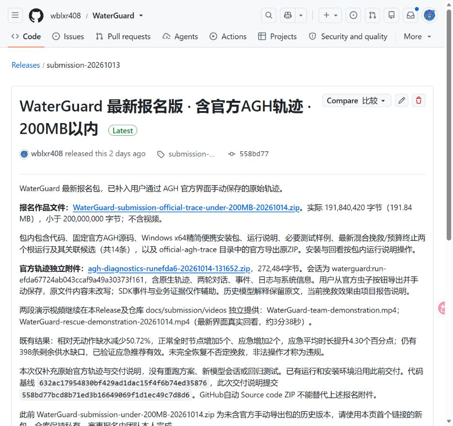
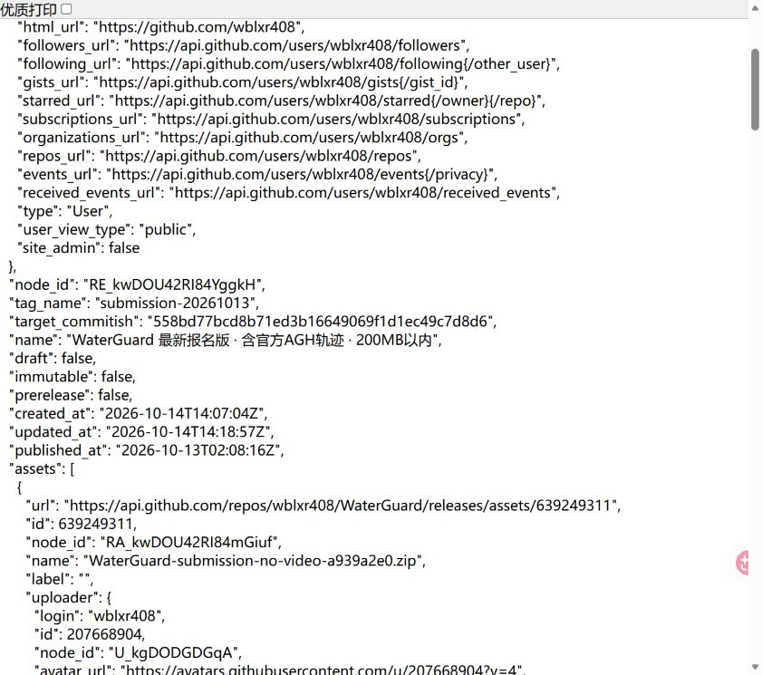

# WaterGuard 公开内容记录

本项采用已发布在 GitHub 的 WaterGuard 项目 Release 作为真实项目记录。

| 项目 | 内容 |
|---|---|
| 公开平台 | GitHub |
| 发布账号 | wblxr408 |
| 项目仓库 | https://github.com/wblxr408/WaterGuard |
| 有效发布链接 | https://github.com/wblxr408/WaterGuard/releases/tag/submission-20261013 |
| 发布记录标题 | WaterGuard 最新报名版 · 含官方AGH轨迹 · 200MB以内 |
| 发布记录 ID / 标签 | 411175175 / submission-20261013 |
| 实际发布日期 | 2026年10月13日10:08:16（北京时间，UTC+8） |
| GitHub 原始发布日期字段 | published_at = 2026-10-13T02:08:16Z |

发布页公开展示项目交付说明、实际仿真结果、代码版本、官方 AGH 轨迹和演示视频下载入口。2026年10月14日核查时，GitHub 仓库元数据为 public，未登录访问也能读取仓库与 Release。发布页正文的“仓库保持私有”是先前交付说明，其描述已过时；当前可见性以实时仓库状态为准。

## 原始页面截图

[项目发布页截图](public-record/github-release.jpg)展示项目名称、账号、发布记录及交付内容。GitHub 发布页默认显示相对时间，因此同时附上[完整发布日期截图](public-record/github-release-published-at.jpg)：该图直接截自 GitHub 官方公开 API 页面，可见相同项目标题、标签和 published_at 完整日期，截图未添加或替换日期。

## 日期核查

官方记录链接：https://api.github.com/repos/wblxr408/WaterGuard/releases/tags/submission-20261013 。其原始响应保存在 public-record/github-release.json。

使用 published_at 作为 Release 发布日期；created_at、updated_at 和附件上传日期分别描述其他事件，不替代发布日期。当前 Release 说明和附件在2026年10月14日更新，原发布记录日期仍为2026年10月13日。

本项记录既有公开项目，没有创建新的发布记录。报名包内的公开内容材料以本文件及 public-record/ 中的两张截图、官方记录为准。
